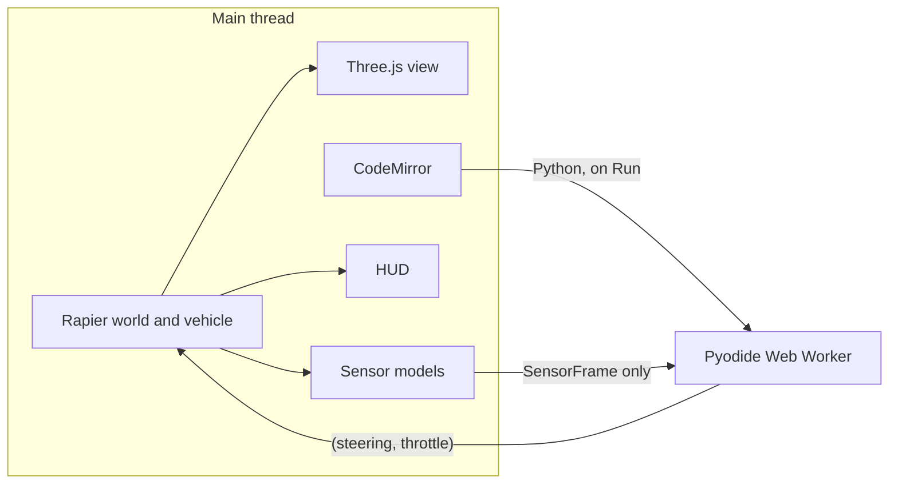

# Robotics Sandbox

An educational robotics simulator that runs entirely in the browser. Open the page, drive an Ackermann-steered buggy around a small proving ground, or write Python that sees only simulated sensors and watch it run in the same 3D world.

There is no backend. The site is a static Vite build.

## Quick start

```bash
npm install
npm run dev
```

Then open the printed local URL. The first `dev` or `build` copies the Pyodide runtime into `public/pyodide/` and downloads the NumPy wheel (see below). `npm run build` writes the static site to `dist/`. `npm test` checks the sensor protocol, the bicycle-model odometry, Ackermann geometry, that a positive steer command turns the car to the driver's left (screen-left from the chase camera), that Run can be repeated after Stop or a timeout, that the lidar-avoid policy makes it up the avenue, and that the other yards stay drivable.

Drive with WASD or the arrow keys. Left and A steer left from the driver's seat: the nose swings toward the left side of the screen while the chase camera stays behind the car, and the same positive command is what `control()` returns. Space brakes. Drag the view to orbit the car, scroll to zoom, and press `R` to reset. The **World** menu switches among city streets, an F1TENTH-style oval, a forest trail, and a warehouse. The choice is remembered, and the car respawns at that yard's start. **Graphics** is High (HDRI lighting, soft shadows, ambient occlusion, a little bloom, and normal maps) or Low (a simpler environment and diffuse textures only). **Code** opens the editor. Drag the divider to resize it. **Lidar on** draws the scan in the world and in the corner inset. Run can be pressed again after Stop, Reset, an edit, or a timeout; Pyodide stays loaded.

## What you are looking at

The car is a Rapier `DynamicRayCastVehicleController`: four suspension rays, front wheels steered with Ackermann geometry, and drive torque split across the axles. The center of mass sits below the body, tire grip is limited so a hard corner slides instead of tripping, and a speed governor eases off when the kinematic lateral acceleration gets large. Braking is a small per-wheel impulse, so Stop settles the car instead of flipping it. Positive steering is a left turn as the driver sees it. At rest the nose points along +Z and the driver's left is +X, which is the left side of the screen with the chase camera behind the car. The tire meshes roll with wheel speed and the knuckles use the same steer angle as the physics, so the tires point the way the car turns. Headlights brighten with throttle and the brake lights come on when you brake or reverse.

The body is an open-wheel research car in the spirit of an F1TENTH stack: a molded shell, carbon floor, aluminum uprights, coil shocks, treaded tires on multi-spoke rims, a compute box with a wiring loom, and a Hokuyo-style lidar puck. The puck sits on the ray origin. The rendered world is Three.js (WebGL2) with AgX tone mapping. High uses a Poly Haven HDRI for image-based lighting and the outdoor sky, soft shadows, a half-resolution GTAO pass, and a faint bloom. Low keeps a generated room environment and the gradient sky. **City streets** is an avenue with a cross street, roundabout, concrete sidewalks, crosswalks, signals, parked cars, and brick buildings. **F1TENTH track** is a closed oval with pipe-insulation walls, kerb paint, a start line, and cones and crates off the inner line. **Forest trail** is a grass-and-dirt path through barked trees and foliage cards, with rocks, logs, a stream, and a plank bridge; the physics ground stays flat so the car does not trip on the visual bumps. **Warehouse** is an aisle yard with metal shelving, wood boxes, and a worn concrete floor. Fixed obstacles are placed by their underside, so the mesh and the collider share the ground, and they are tall enough for the lidar plane. Switching worlds swaps that collider set and respawns the car. The sensor API does not change. The chase camera follows the chassis. **Lidar on** draws a light planar scan plus a top-down inset.

Surfaces are CC0 PBR textures from [Poly Haven](https://polyhaven.com), encoded to KTX2/ETC1S and decoded in the page with the Basis transcoder shipped in Three.js (`three/examples/jsm/libs/basis`, MIT). Each world loads its own set the first time you select it. High also loads normal and roughness maps; Low uses the diffuse map only. Geometry is built in the page (no third-party mesh), so there is no Draco or meshopt payload. The HDRI is Poly Haven `kloofendal_48d_partly_cloudy_puresky` (CC0). Texture sweeps, also CC0: `asphalt_02`, `concrete_floor_worn_001`, `brick_wall_04`, `forest_floor`, `leafy_grass`, `bark_brown_02`, `brown_planks_09`, `metal_plate`. Markings, foliage cards, and the car's carbon weave are generated in the page. Three.js's `RoomEnvironment`, `GTAOPass`, and `UnrealBloomPass` come from the Three.js examples shipped with the `three` package.

Physics steps at 60 Hz. Student code runs at 20 Hz.

## Architecture



Ground-truth pose and velocity stay on the main thread. They are used to integrate physics, to aim the camera, and to draw the HUD. The worker never imports the simulator. Before every `postMessage`, the host copies the sample through `publishSensorFrame`, which keeps a fixed set of fields and drops anything else, then `assertNoBannedKeys` rejects names such as `groundTruth`, `translation`, `linvel`, or `position`.

Pyodide stays loaded across Run and Stop. Each Run loads the editor buffer under a new id, so Stop, Reset, switching examples, or editing and running again all start the program over. Replies from the previous attempt are ignored. The worker is terminated and created again only if a tick or the program load does not return (an infinite loop cannot be unwound from inside Python); the next Run boots a fresh interpreter. `print()` and Python tracebacks show up in the console panel. Top-level statements run once per **Run**; `control` is called on each tick and can use that state. Ctrl or ⌘ Enter runs the buffer, including when focus is in the editor.

| Path | Role |
| --- | --- |
| `src/api/` | Student-facing types, the publish/clamp gate, bicycle-model odometry, Ackermann angles, robot descriptor. No Three.js and no Rapier. |
| `src/robots/types.ts` | `SimRobot`. A new platform implements this and still speaks `SensorFrame` / `ControlCommand`. |
| `src/sim/` | World, vehicle, sensor models, camera, lidar overlay. |
| `src/sandbox/` | Pyodide worker and its host. The worker imports only `src/api` and Pyodide. |
| `src/editor/` | CodeMirror (Python) and the two starter programs. |
| `src/lessons` | Not a package yet. The example list in `src/editor/examples.ts` is the seed for lessons. |

### Why these libraries

- **Rapier** (`@dimforge/rapier3d-compat`) for the raycast vehicle and the lidar raycasts. The compat build inlines WASM as base64, so a static host does not need a special WASM content type.
- **Three.js `WebGLRenderer`**, not `WebGPURenderer`. Shadows and `MeshStandardMaterial` are predictable on WebGL2, including machines with no WebGPU adapter. Rendering is isolated in `src/sim/scene.ts`; swapping in `WebGPURenderer` (it already falls back to WebGL2) does not touch physics or the student API.
- **CodeMirror 6** for the editor, with Python highlighting.
- **Pyodide 0.29.5** for the student interpreter, plus NumPy. `scripts/fetch-pyodide.mjs` copies the runtime out of `node_modules/pyodide` into `public/pyodide/` and downloads the NumPy wheel beside it (checksummed against `pyodide-lock.json`). Those files are same-origin in `dist/`, so COEP does not depend on a CDN when the page is open. The wheel itself is fetched from jsDelivr only at build time; that host sends `Cross-Origin-Resource-Policy: cross-origin` and `Access-Control-Allow-Origin: *`.

Cross-origin isolation (COOP/COEP) is turned on because Pyodide can use `SharedArrayBuffer`. Dev and `vite preview` send the headers themselves. The runtime is lazy: it downloads when you first open **Code**, and the panel shows “Loading Python and NumPy…” until it is ready.

## Student API

`control(sensors)` runs at 20 Hz. Return `(steering, throttle)` or `{"steering": ..., "throttle": ...}`.

- `steering` — radians, positive is a left turn from the driver's seat (and the left side of the chase view), clamped to ±0.55. The keyboard uses that same sign.
- `throttle` — −1 … 1, positive forward, clamped to that range.

The robot frame is x forward, y left, z up. Yaw is counterclockwise from above. The wheelbase is 1.9 m (`src/api/descriptor.ts`). Sensors are attribute-style objects. Lidar ranges and angles are NumPy arrays.

```python
import numpy as np

def control(sensors):
    # sensors.lidar.ranges, sensors.lidar.angles, sensors.lidar.max_range
    # sensors.odometry.speed, sensors.odometry.steering_angle, sensors.odometry.pose
    # sensors.imu.yaw_rate, sensors.imu.accel.x / .y / .z
    # sensors.time, sensors.dt
    nearest = float(np.min(sensors.lidar.ranges))
    return 0.34, 0.5
```

There is no ground-truth pose channel and no velocity channel. The host copies the sample through `publishSensorFrame` before `postMessage`, then the worker builds the Python objects from that JSON only.

### Sensors

All of these are noisy. None of them is the body's true pose.

| Channel | Contents |
| --- | --- |
| Lidar | 360 planar beams, 25 m max range, about 3.5 cm of range noise. Angle 0 is forward, positive is left. `max_range` means no return. The ray starts at the roof puck and does not hit the chassis. In Python this is `sensors.lidar.ranges` and `sensors.lidar.angles`. |
| Wheel odometry | Rear-wheel speed and the actuator steering angle, plus noise. `pose` is a bicycle-model integral of those noisy readings. It starts at the origin on reset and drifts. It is not where the car is in the world. |
| IMU | Yaw rate about body +z, and specific force in the robot frame (about +9.81 m/s² on +z when level and still), with a bias chosen at reset and white noise. |
| Camera | Stub, `{ available: false }`. A later version can attach pixels here without changing the call shape. |

The HUD shows true forward speed next to odometry speed, and commanded steering next to the slewed actuator angle. True speed is for the person watching. It is not sent to the program.

The editor examples are **Circle drive** (open-loop steer and throttle, turning left), **Lidar avoid** (aim at the most open forward beam, same sign as the driver), and **Wall follow** (the same idea with a bias toward the driver's right, which laps the oval). Ctrl or ⌘ Enter runs the buffer from anywhere on the page, including inside the editor.

## Adding a robot or a lesson

- **Another robot.** Implement `SimRobot` in `src/robots/types.ts`. Build its collider in `src/sim/`, and keep returning a `SensorFrame`. The sandbox does not change.
- **Lessons.** Add an entry beside the examples in `src/editor/examples.ts` (id, label, source). A lesson runner can later load those by id. A second language can be another worker that speaks the same tick and result messages.

## Deploy

### Cloudflare Pages

| Setting | Value |
| --- | --- |
| Build command | `npm run build` |
| Build output directory | `dist` |
| Root directory | repository root |
| Node | 22 |

Do not set `GITHUB_PAGES`. The production base path is `/`.

`public/_headers` is copied into `dist/` and tells Cloudflare to send:

```
Cross-Origin-Opener-Policy: same-origin
Cross-Origin-Embedder-Policy: require-corp
```

### GitHub Pages

The workflow `.github/workflows/pages.yml` builds on pushes to `main` (and on manual dispatch) and deploys with GitHub Actions. In the repo settings, set **Pages → Build and deployment → Source** to **GitHub Actions**.

The site is served at `https://<user>.github.io/robo-sim-lab/`. The workflow sets `GITHUB_PAGES=true`, which does two things:

- Vite `base` is `/robo-sim-lab/`.
- `coi-serviceworker.js` is emitted next to `index.html` and loaded from the page. GitHub Pages cannot set COOP/COEP itself; the service worker reloads once and applies them. It is not injected for Cloudflare or for local dev, where the real headers are already present (loading both will fight).

The workflow also writes `dist/.nojekyll` so GitHub does not drop `_headers` or other underscored files. The Pyodide runtime and NumPy wheel are part of `dist/pyodide/` and are loaded from that same origin, including after `coi-serviceworker.js` reloads the page into cross-origin isolation.
