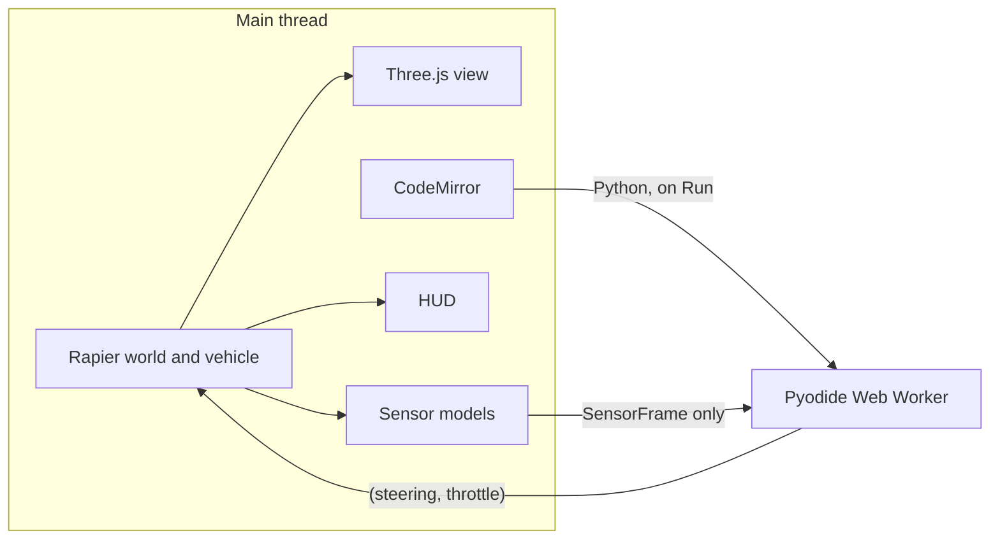

# Robotics Sandbox

An educational robotics simulator that runs entirely in the browser. Open the page, drive an Ackermann-steered buggy around a small proving ground, or write Python that sees only simulated sensors and watch it run in the same 3D world.

There is no backend. The site is a static Vite build.

## Quick start

```bash
npm install
npm run dev
```

Then open the printed local URL. The first `dev` or `build` copies the Pyodide runtime into `public/pyodide/` and downloads the NumPy wheel (see below). `npm run build` writes the static site to `dist/`. `npm test` checks the sensor protocol, gyro-heading odometry, Ackermann geometry, that a positive steer command turns the car to the driver's left (screen-left from the chase camera), that Run can be repeated after Stop or a timeout, that the lidar-avoid policy makes it up the avenue, and that the other yards stay drivable.

Drive with WASD or the arrow keys. Left and A steer left from the driver's seat: the nose swings toward the left side of the screen while the chase camera stays behind the car, and the same positive command is what `control()` returns. Space brakes. Drag the view to orbit the car, scroll to zoom, and press `R` to reset. The **World** menu switches among city streets, an F1TENTH-style oval, a forest trail, and a warehouse. The choice is remembered, and the car respawns at that yard's start. **Graphics** is High (HDRI lighting, soft shadows, ambient occlusion, a little bloom, and normal maps) or Low (a simpler environment and diffuse textures only). **Code** opens the editor. Drag the divider to resize it. **Lidar on** draws the scan in the world and in the corner inset. Run can be pressed again after Stop, Reset, an edit, or a timeout; Pyodide stays loaded.

## What you are looking at

The car is a Rapier `DynamicRayCastVehicleController`: four suspension rays, front wheels steered with Ackermann geometry, and drive torque split across the axles. The center of mass sits below the body, tire grip is limited so a hard corner slides instead of tripping, and a speed governor eases off when the kinematic lateral acceleration gets large. Braking is a small per-wheel impulse, so Stop settles the car instead of flipping it. Positive steering is a left turn as the driver sees it. At rest the nose points along +Z and the driver's left is +X, which is the left side of the screen with the chase camera behind the car. The tire meshes roll with wheel speed and the knuckles use the same steer angle as the physics, so the tires point the way the car turns. Headlights brighten with throttle and the brake lights come on when you brake or reverse.

The body is an F1TENTH-style electronics buggy: twin chassis rails, shock towers, a front bumper, a strapped LiPo, a Jetson-style board with a heatsink and fan, coil shocks, knobby short-course tires, a stereo camera, and an orange-and-black Hokuyo-style lidar on a front standoff. The lidar housing center is the ray origin. The rendered world is Three.js (WebGL2) with AgX tone mapping. High uses a Poly Haven HDRI as the visible sky and for image-based lighting, soft shadows, a half-resolution GTAO pass, and a faint bloom. Low keeps a generated room environment and the gradient sky. **City streets** is an avenue with a cross street, roundabout, concrete sidewalks, crosswalks, signals, parked cars, and brick buildings. **F1TENTH track** is a closed oval with pipe-insulation walls, kerb paint, a start line, and cones and crates off the inner line. **Forest trail** is a grass-and-dirt path through barked trees and foliage cards, with rocks, logs, a stream, and a plank bridge; the physics ground stays flat so the car does not trip on the visual bumps. **Warehouse** is an aisle yard with metal shelving, wood boxes, and a worn concrete floor. Fixed obstacles are placed by their underside, so the mesh and the collider share the ground, and they are tall enough for the lidar plane. Switching worlds swaps that collider set and respawns the car. The sensor API does not change. The chase camera follows the chassis. **Lidar on** draws a light planar scan plus a top-down inset.

Surfaces are CC0 PBR textures, encoded to KTX2/ETC1S and decoded in the page with the Basis transcoder shipped in Three.js (`three/examples/jsm/libs/basis`, MIT). Each world loads its own set the first time you select it. High also loads normal and roughness maps; Low uses the diffuse map only. Repeated props are instanced Poly Haven photogrammetry models (CC0), simplified and stored as meshopt glTF with KTX2/ETC1S textures: `island_tree_02`, `fir_sapling`, `searsia_lucida`, `shrub_02`, `fern_02`, `grass_medium_02`, `boulder_01`, `rock_07`, `dead_tree_trunk`, `wooden_crate_01`, `Barrel_01`, `painted_wooden_bench`, `street_lamp_01`, and `water_manhole_cover`. Buildings, the research car, and parked-car bodies are still built in the page. The sky HDRI is Poly Haven `kloofendal_48d_partly_cloudy_puresky` (CC0) and is shown directly; the blurry PMREM copy is only the reflection probe. Texture sweeps: ambientCG `Grass001` (CC0) for lawns; Poly Haven `asphalt_track`, `forest_ground_05`, `concrete_floor_worn_001`, `brick_wall_04`, `bark_brown_02`, `brown_planks_09`, and `metal_plate` (CC0). Grass blades, markings, and the car's carbon weave are generated in the page. Three.js's `RoomEnvironment`, `GTAOPass`, and `UnrealBloomPass` come from the Three.js examples shipped with the `three` package.

Physics steps at 60 Hz. Student code runs at 20 Hz.

## Architecture



Ground-truth pose and velocity stay on the main thread. They are used to integrate physics, to aim the camera, and to draw the HUD. The worker never imports the simulator. Before every `postMessage`, the host copies the sample through `publishSensorFrame`, which keeps a fixed set of fields and drops anything else, then `assertNoBannedKeys` rejects names such as `groundTruth`, `translation`, `linvel`, or `position`.

Pyodide stays loaded across Run and Stop. Each Run loads the editor buffer under a new id, so Stop, Reset, switching examples, or editing and running again all start the program over. Replies from the previous attempt are ignored. The worker is terminated and created again only if a tick or the program load does not return (an infinite loop cannot be unwound from inside Python); the next Run boots a fresh interpreter. `print()` and Python tracebacks show up in the console panel. Top-level statements run once per **Run**; `control` is called on each tick and can use that state. Ctrl or ⌘ Enter runs the buffer, including when focus is in the editor.

| Path | Role |
| --- | --- |
| `src/api/` | Student-facing types, the publish/clamp gate, wheel-speed and gyro odometry, Ackermann angles, robot descriptor. No Three.js and no Rapier. |
| `src/robots/types.ts` | `SimRobot`. A new platform implements this and still speaks `SensorFrame` / `ControlCommand`. |
| `src/sim/` | World, vehicle, sensor models, camera, lidar overlay. |
| `src/sandbox/` | Pyodide worker and its host. The worker imports only `src/api` and Pyodide. |
| `src/editor/` | CodeMirror (Python) and the starter programs, including the particle filter. |
| `src/lessons/` | Course markdown. One file per lesson. See below. |
| `src/course/` | Sidebar, hash routes, KaTeX rendering, and saved progress. |

### Why these libraries

- **Rapier** (`@dimforge/rapier3d-compat`) for the raycast vehicle and the lidar raycasts. The compat build inlines WASM as base64, so a static host does not need a special WASM content type.
- **Three.js `WebGLRenderer`**, not `WebGPURenderer`. Shadows and `MeshStandardMaterial` are predictable on WebGL2, including machines with no WebGPU adapter. Rendering is isolated in `src/sim/scene.ts`; swapping in `WebGPURenderer` (it already falls back to WebGL2) does not touch physics or the student API.
- **CodeMirror 6** for the editor, with Python highlighting.
- **Pyodide 0.29.5** for the student interpreter, plus NumPy. `scripts/fetch-pyodide.mjs` copies the runtime out of `node_modules/pyodide` into `public/pyodide/` and downloads the NumPy wheel beside it (checksummed against `pyodide-lock.json`). Those files are same-origin in `dist/`, so COEP does not depend on a CDN when the page is open. The wheel itself is fetched from jsDelivr only at build time; that host sends `Cross-Origin-Resource-Policy: cross-origin` and `Access-Control-Allow-Origin: *`.

Cross-origin isolation (COOP/COEP) is turned on because Pyodide can use `SharedArrayBuffer`. Dev and `vite preview` send the headers themselves. The runtime is lazy: it downloads when you first open **Code**, and the panel shows “Loading Python and NumPy…” until it is ready.

## Student API

`control(sensors)` runs at 20 Hz. Return `(steering, throttle)` or `{"steering": ..., "throttle": ...}`.

- `steering` — radians, positive is a left turn from the driver's seat (and the left side of the chase view), clamped to ±0.55. The keyboard uses that same sign.
- `throttle` — −1 … 1, positive forward, clamped to that range.

The robot frame is x forward, y left, z up. Yaw is counterclockwise from above. The wheelbase is 1.9 m (`src/api/descriptor.ts`). Sensors are attribute-style objects. Lidar ranges and angles are NumPy arrays.

```python
import numpy as np

def control(sensors):
    # sensors.lidar.ranges, sensors.lidar.angles, sensors.lidar.max_range
    # sensors.odometry.speed, sensors.odometry.steering_angle, sensors.odometry.pose
    # sensors.imu.yaw_rate, sensors.imu.accel.x / .y / .z
    # sensors.task.path          waypoints in the odometry frame
    # sensors.time, sensors.dt
    nearest = float(np.min(sensors.lidar.ranges))
    draw.path(sensors.task.path, "#7dcea0")
    return 0.34, 0.5
```

There is no ground-truth pose channel and no velocity channel. The host copies the sample through `publishSensorFrame` before `postMessage`, then the worker builds the Python objects from that JSON only. `draw` is the other direction: the worker posts a list of shapes with the command, and the view renders them. Those shapes are not read back into Python.

### Sensors

All of these are noisy. None of them is the body's true pose.

| Channel | Contents |
| --- | --- |
| Lidar | 270 planar beams over 270°, 12 m max range, 2 cm one-sigma range noise. Angle 0 is forward, positive is left. `max_range` means no return. The ray starts at the roof puck and does not hit the chassis. In Python this is `sensors.lidar.ranges` and `sensors.lidar.angles`. |
| Wheel odometry | Rear-wheel speed, the actuator steering angle, and a pose. Physics already slips the tires. Each reset draws a speed bias (1.2% one-sigma) and a steering bias (0.004 rad one-sigma), plus white noise of 2 cm/s and 0.003 rad. Heading is the integral of the gyro yaw rate, not `(speed / wheelbase) * tan(steer)`. The steering bias is reported on `steering_angle` and is not integrated. A bicycle-model heading turned that small steer bias into a curvature bias, which walked one oval lap about 50 m off the car. The gyro bias is 0.0012 rad/s one-sigma (about 0.07 deg/s); over 60 s that is a few degrees and a few metres of cross-track, under 5% of distance, and still visible on the amber trail. The speed bias is what scales distance. `pose` starts at the origin on reset. It is not where the car is in the world. |
| IMU | Yaw rate about body +z, and specific force in the robot frame (about +9.81 m/s² on +z when level and still). Gyro white noise is 0.002 rad/s with a 0.0015 rad/s bias chosen at reset. Accelerometer white noise is 0.04 m/s² with a 0.02 m/s² bias. |
| Camera | Stub, `{ available: false }`. A later version can attach pixels here without changing the call shape. |
| Task | `sensors.task.path`, a list of `{x, y}` waypoints in the odometry frame. Each world publishes one: the oval centerline, the city roundabout, the forest trail (out through the trunks, back on the west lane), and the warehouse loop on the open floor south of the bay rack. `sensors.task.map` is a known floor plan in that same frame: `resolution`, `corner` (the cell-(0, 0) anchor — not a pose), `width`, `height`, `field` (base64 centimetres of distance to the nearest occupied cell; 0 is occupied), `segments` (wall edges packed `x0, y0, x1, y1`), and `stamp`. The grid covers the path plus the lidar's reach. This is a map the robot is given. It is not the car's pose. |

The numbers live in `src/api/descriptor.ts` (`ACKERMANN_BUGGY.sensors`). That is the only sensor config. A Hokuyo UST-10LX, the usual F1TENTH lidar, is 270°, 1081 beams (0.25°), 10 m, ±40 mm, and 40 Hz. This sandbox keeps the 270° field and a 12 m range, publishes one scan per 20 Hz control tick, and keeps every fourth hardware angle (about 1°) so the raycasts stay interactive. Range noise of 2 cm sits inside the 1–3 cm band of that sensor. On a real F1TENTH car, wheel odometry plus a gyro is typically 1–5% of distance, a few metres per lap, not tens of metres. The pose here is built the same way: distance from the biased wheel speed, heading from the biased gyro. **Reset seed** replays the same noise. **Paths** draws the true trail (coloured by speed) and the odometry trail (amber) in the view. Both are render-only: they are not fields on the sensor frame and they are not posted to the worker.

The HUD shows true forward speed next to odometry speed, and commanded steering next to the slewed actuator angle. True speed is for the person watching. It is not sent to the program.

### Debug drawings

`draw` is in scope inside `control`. Coordinates are the odometry frame, the same one as `sensors.odometry.pose` and `sensors.task.path`. The host places them with the spawn transform, so a path the student was given stays on the map, and a point computed from a drifting pose walks away from the car. That picture is rendering only. It is not a sensor.

```python
draw.path(points, "#7dcea0")    # points are {x, y} or (x, y), at least two
draw.points(points, "#f4d03f")  # optional 3rd/4th value: yaw, weight
draw.text(x, y, "lookahead", "#f4f1ea")
```

Colors are `#rrggbb`. The 3D view and the lidar inset both draw the list. Point clouds are pixel-sized dots a few centimetres off the ground, with a short heading tick when a yaw is present, brighter when the weight is higher. The inset is centered on the pose the program estimates, not on the true pose. A spread-out cloud widens the inset so the dots stay on the dial.

`sensors.task.map.grid` is a NumPy array of that distance field in metres, decoded once before the timed `control` call. `field` is still the base64 form. An optional `init(sensors)` runs once per map stamp, outside the timed step, so a program can warm that table without spending the 20 Hz budget.

### Pure pursuit

The **Pure pursuit** example tracks `sensors.task.path` with a lookahead and a small speed PID. It draws the path, the lookahead point, and the arc implied by the steering command. Because the pose is odometry, cross-track error against the true trail grows over the minute. The eval records mean and max cross-track, lap time, and contacts, and the path plot draws the planned path against the driven one.

**PF pursuit** is the same law using a particle-filter mean instead of raw odometry. **PF kidnapped** starts most of that cloud over the free cells, with a route lattice so a few hundred poses can still land on the car, and creeps with the wall follower until one particle owns the scan. Both draw particles and the estimate with `draw.points` and `draw.path`, and a 2-sigma ellipse with `draw.ellipse`. The eval reads the short heading tick (`#ffe08a`) as the student's estimate and scores it against the true pose. That comparison stays in the eval. It is not a sensor.

`npm run eval` runs every example in every world for 60 s of simulated time, headless, with the same physics, the same sensor code, and the same Python prelude as the browser. It writes `eval/out/<world>/<example>/metrics.json`, a top-down `path.png` (legend, metre scale bar, roads, curbs, and the trail outline), `eval/out/contact-sheet.png`, and `eval/out/summary.md`. `npm run eval:ci` is that same 60 s suite with gates on contacts, stuck time, and drift as a percent of distance. GitHub Actions runs it on every push to `main`.

The editor examples are **Circle drive**, **Lidar avoid**, **Wall follow**, **Pure pursuit**, **PF pursuit**, and **PF kidnapped**. Wall follow starts beside a real wall. Pure pursuit and both particle-filter examples start on the path, headed along the first segment. Ctrl or ⌘ Enter runs the buffer from anywhere on the page, including inside the editor.

Drive, Code, and Lessons are hash routes: `#/drive` (also the old `#/sandbox`), `#/code`, and `#/lesson/<module>/<slug>`. An old `#/lesson/.../lab` link opens that same lesson, with the simulator already configured beside the reading. GitHub Pages does not rewrite paths, so the course does not use history paths.

## Adding a lesson

Lessons are markdown files under `src/lessons/<module>/<slug>.md`. The course picks them up with a glob. No registry edit.

```markdown
---
title: Wall following
order: 3
world: track
spawn: wall
starter: wall
action: lab
prerequisites: reactive/avoid
status: ready
---

The reading. Use `$inline$` and `$$display$$` math. SVG can sit inline. Headings should name the idea, not a repeated template.
```

| Field | Meaning |
| --- | --- |
| `title`, `order` | Lesson label and order within the module. Module order is the list in `src/course/catalog.ts`. |
| `world` | `city`, `track`, `forest`, or `warehouse`. Opening the lesson switches to it. |
| `spawn` | `default`, `circle`, `avoid`, `wall`, `pursuit`, `mcl`, or `mcl-global`. These are the scenario spawns. |
| `starter` | An example id from `src/editor/examples.ts`, or `none`. A starter is loaded into the Try it editor and run. The editor starts collapsed; Edit code opens it. |
| `action` | `lab` runs starter code, `drive` leaves the keyboard in control, `sandbox` is a reading with the sim configured and no program. |
| `prerequisites` | Comma-separated lesson ids, `module/slug`. |
| `status` | `ready` or `soon`. |

Opening a lesson sets that world and spawn, seed 1, and the lidar, path, and camera preset for the lesson. Edits and visited/completed marks live in `localStorage`. **Reset to starter** drops the saved edit.

Math is [KaTeX](https://katex.org/), bundled from `node_modules`. Do not add a CDN link. The page is cross-origin isolated.

- **Another robot.** Implement `SimRobot` in `src/robots/types.ts`. Build its collider in `src/sim/`, and keep returning a `SensorFrame`. The sandbox does not change.
- **Another example.** Add an entry in `src/editor/examples.ts`, then point a lesson's `starter` at its id. A world path is `referenceRoute` in `src/sim/routes.ts`, published on `sensors.task.path`. The known map is `buildKnownMap` in `src/sim/known-map.ts`.

## Deploy

### Cloudflare Pages

| Setting | Value |
| --- | --- |
| Build command | `npm run build` |
| Build output directory | `dist` |
| Root directory | repository root |
| Node | 22 |

Do not set `GITHUB_PAGES`. The production base path is `/`.

`public/_headers` is copied into `dist/` and tells Cloudflare to send:

```
Cross-Origin-Opener-Policy: same-origin
Cross-Origin-Embedder-Policy: require-corp
```

### GitHub Pages

The workflow `.github/workflows/pages.yml` builds on pushes to `main` (and on manual dispatch) and deploys with GitHub Actions. In the repo settings, set **Pages → Build and deployment → Source** to **GitHub Actions**.

The site is served at `https://<user>.github.io/robo-sim-lab/`. The workflow sets `GITHUB_PAGES=true`, which does two things:

- Vite `base` is `/robo-sim-lab/`.
- `coi-serviceworker.js` is emitted next to `index.html` and loaded from the page. GitHub Pages cannot set COOP/COEP itself; the service worker reloads once and applies them. It is not injected for Cloudflare or for local dev, where the real headers are already present (loading both will fight).

The workflow also writes `dist/.nojekyll` so GitHub does not drop `_headers` or other underscored files. The Pyodide runtime and NumPy wheel are part of `dist/pyodide/` and are loaded from that same origin, including after `coi-serviceworker.js` reloads the page into cross-origin isolation.
